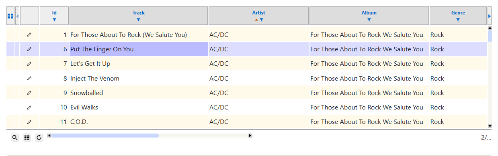
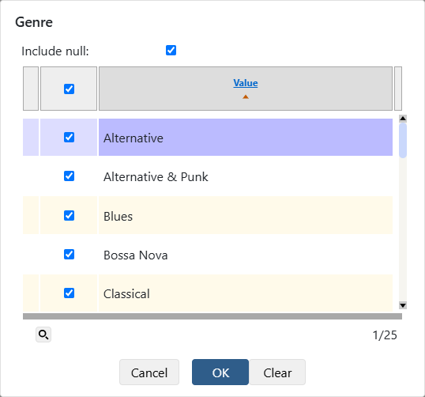
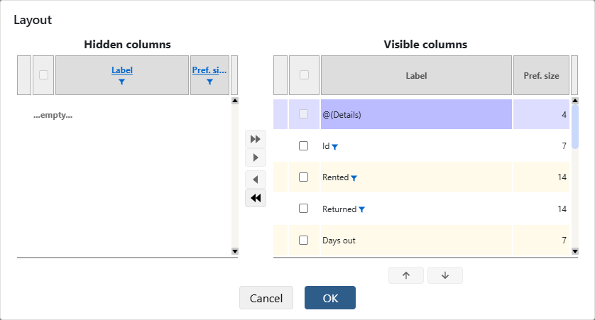
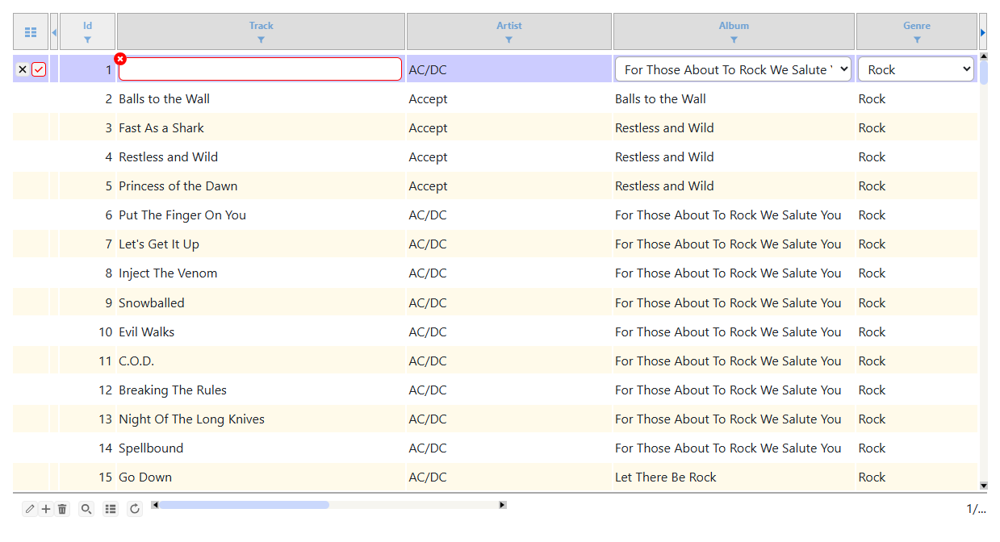
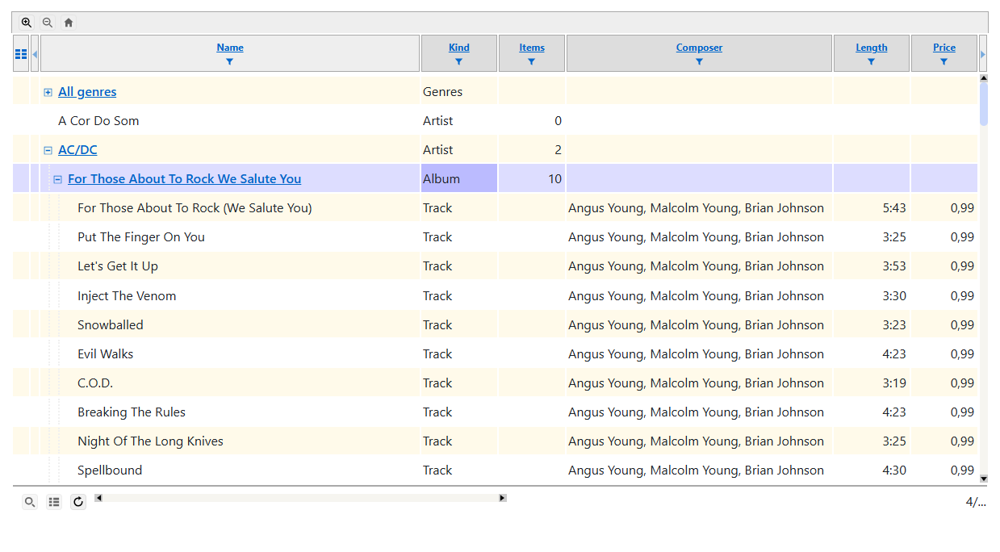
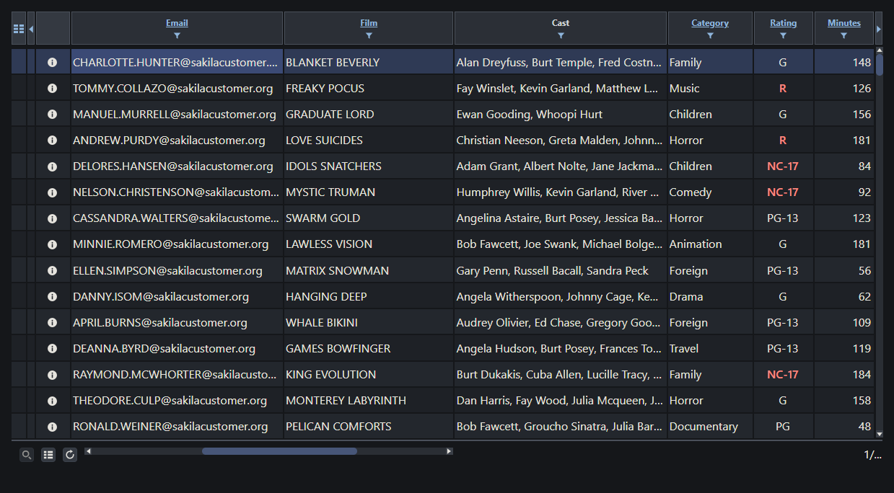

# Glazor

**High-performance data grids and UI essentials for .NET 10 Blazor.**

[](https://dotnet.microsoft.com/)
[](https://www.nuget.org/packages/Glazor)
[](https://github.com/gse-srl/Glazor/blob/main/LICENSE.txt)

Glazor is a Razor Class Library built around **`Grigliaria`** — a data grid designed for tables that are too
large to render naively. It pages instead of virtualizing, pushes filters and sorting down to the database when
backed by EF Core, and keeps its column layout, filters and sort order in a serializable snapshot you can persist.

```razor
<Grigliaria TGridItem="Product" Model="_model" Layoutable="true" Spinner="@Gui.Spinner"
            VertResizer="@(GridVertResizers.RowHeight("height: 60vh;", 4, 30))">
    <GridColumn EFProperty="@(x => x.Code)"  Name="Code"  Label="Code" Fixed="true" PreferredSize="10" />
    <GridColumn EFProperty="@(x => x.Name)"  Name="Name"  Label="Name" PreferredSize="30" />
    <GridColumn EFProperty="@(x => x.Price)" Name="Price" Label="Price" Alignment="Alignment.Right" />
</Grigliaria>
```

`Gui` is a cascaded object of the application's layout that holds its one `Spinner`, which a grid over an EF model
needs: see [Getting started](https://github.com/gse-srl/Glazor/blob/main/docs/getting-started.md).

## Contents

| Guide | What it covers |
| --- | --- |
| **[Getting started](https://github.com/gse-srl/Glazor/blob/main/docs/getting-started.md)** | Install, register assets, first grid |
| **[Grigliaria](https://github.com/gse-srl/Glazor/blob/main/docs/grigliaria.md)** | The data grid in depth — columns, filters, layout, keyboard, templates |
| **[Data models](https://github.com/gse-srl/Glazor/blob/main/docs/data-models.md)** | `GridModel`, `DataGridModel`, `EFDataGridModel`, editing |
| **[Architecture & components](https://github.com/gse-srl/Glazor/blob/main/docs/Technical_Documentation.md)** | Namespaces, and the `Popup`/`DialogBox`/`Spinner`/`Tabs` family |
| **[AI skill](https://github.com/gse-srl/Glazor/blob/main/.claude/skills/glazor/SKILL.md)** | For Claude Code: how to use Glazor, the gotchas included |

To use the skill in your own project, copy the `.claude/skills/glazor` folder into your project's `.claude/skills/`,
taken from the tag that matches your Glazor version. Its code samples are compiled against the library by the test suite.

## Features

**Grids**

- **`Grigliaria`** — the flagship data grid: paged rendering, per-column filters, sorting, column
  reordering/hiding, fixed columns, column groups, cell cursor, incremental search, touch scrolling,
  a row dialog that lists the current row's columns, those out of view included.
- **`Treegliaria`** — hierarchical rows over the same column and filter machinery.
- **`MultiSelGrid`** — adds a selection column with tri-state select-all.

**Data sources**

- **`EFDataGridModel<TDbContext, TGridItem>`** — filters and sorting on `EFProperty` columns become SQL. Reads incrementally, so a
  million-row table costs few pages of memory; rows already read are kept in chunks spilled to disk as
  plaintext MessagePack, in the OS temp directory unless `SpillDirectory` says otherwise. See
  [Data models › Paging stores rows on disk](https://github.com/gse-srl/Glazor/blob/main/docs/data-models.md#paging-stores-rows-on-disk).
- **`DataGridModel<TGridItem>`** / **`GridModel<TGridItem>`** — in-memory lists.
- **`Editable*`** variants for insert/edit/cancel flows.

**UI essentials**

`Popup`, `DialogBox`, `Spinner`, `Tabs`, `TriStateCheckbox`, `Clamper`, `KeyAction`, `MouseAction`,
`ResizeObserver`, `TouchScroller`, `Scroller`.

**Localized** — the components' own texts come in English and Italian and follow the current UI culture; a host
registers an `IGlazorTexts` for other wording or languages. See
[Architecture › Localization](https://github.com/gse-srl/Glazor/blob/main/docs/Technical_Documentation.md#localization).

**Themable** — every colour and icon is a `--glazor-*` custom property; a dark theme ships as `glazor-dark.css`, two more as `glazor-aurora.css` and `glazor-paper.css`, and a
host redefines the properties for its own. No images and no icon font: every icon is an SVG mask that takes the theme's
colours. See
[Architecture › Theming](https://github.com/gse-srl/Glazor/blob/main/docs/Technical_Documentation.md#theming).

## Screenshots

From the demo in the repository, over the Chinook and Sakila sample databases in SQLite.

**A paged grid over EF Core.** Sorted by Artist, with a filter on every column; sort and filters run as SQL over the whole
table, and the footer has the search, the row dialog and the reload.



**Filters and layout.** A filter that lists the values its column holds, read from the database; and the layout dialog,
where the user picks, orders and sizes the columns, saved with the filters and the sort in a `Memento`.

 

**Editing in place.** The row edited in the grid, with the cancel and save buttons on its heading and the validation
message on the field that breaks a rule.



**Trees.** `Treegliaria` over an EF Core folder model: artists, their albums and their tracks, read one folder at a time,
with the zoom bar above.



**Themes.** The dark theme, over a grid whose cells take a class from their value: the adult ratings in red.



## Requirements

- .NET 10
- A Blazor Server project interactive from the root, with the render mode on `HeadOutlet` and `Routes` in `App.razor`.
  **`EFDataGridModel` is server-only**: it fetches rows during rendering and blocks the circuit while it waits, and
  blocking waits are not available on the single-threaded WebAssembly runtime. The in-memory models and the UI
  components have not been tested on WebAssembly.
- **Reflection** — persisting a grid's state (`Memento`) uses the reflection-based `System.Text.Json` serializer and runtime
  type loading; it does not work with a source-generated serializer context, trimming or ahead-of-time publishing. Glazor is
  not trimmable.
- **Entity Framework Core 10 or later**, only for the paged models: `EFDataGridModel` and `EditableEFDataGridModel` ship in
  the separate `Glazor.EntityFrameworkCore` package, which references `Microsoft.EntityFrameworkCore` 10.0.0 or later. It is
  built against EF Core 10.0.0 and tested on a later 10.0 patch; a newer EF Core is accepted and works as long as EF keeps the API the package uses. The
  database provider is the host's own package; Glazor is used and tested on SQL Server, and its test suite and demo run on
  SQLite. Another provider may order rows differently, nulls and collations among them, see the [roadmap](https://github.com/gse-srl/Glazor/blob/main/ROADMAP.md). The
  `Glazor` package, with the in-memory models and the UI components, does not depend on EF Core, nor on MessagePack, which
  only the paged models use. MessagePack brings its source generator into the host's build, which a host can remove, see
  [Data models › Requirements and gotchas](https://github.com/gse-srl/Glazor/blob/main/docs/data-models.md#requirements-and-gotchas).

## Installation

```bash
dotnet add package Glazor
```

To see the components before adding the package, run the demo in the repository and open the address it prints; it has
the grids, two paged grids over the Chinook and Sakila sample databases in SQLite, one of them also edited in the grid
itself, personalized columns, the tree, the tabs, the dialogs and a switch for the dark theme:

```bash
dotnet run --project Glazor.Demo
```

For grids over an EF Core query add the second package too; it pulls in `Glazor` at exactly the same version, since it
uses its internals, so the two are released together and a project that references both upgrades both at once:

```bash
dotnet add package Glazor.EntityFrameworkCore
```

Then reference the stylesheet in `App.razor`:

```html
<link href="_content/Glazor/glazor.css" rel="stylesheet" />
```

The stylesheet styles only elements that carry the library's own `glazor` class beside their own (`glazor popup`, `glazor dialog`, `glazor
clamper`, `glazor disabled`, `glazor message-icon`), so your `.popup`, `.dialog`, `.disabled` or `.message-icon` rules and Glazor's do not
meet.

See **[Getting started](https://github.com/gse-srl/Glazor/blob/main/docs/getting-started.md)** for the rest of the wiring, including the one line of
`Program.cs` setup that turns on logging inside the library.

## License

Copyright © 2025-2026 G.S.E. Servizi Evoluti s.r.l. Licensed under Apache-2.0 — see [LICENSE.txt](https://github.com/gse-srl/Glazor/blob/main/LICENSE.txt).

**DISCLAIMER:** This documentation and some tests were generated with the assistance of artificial intelligence (AI). 
The final content has been reviewed, edited, and verified by a human professional to ensure accuracy and quality.
